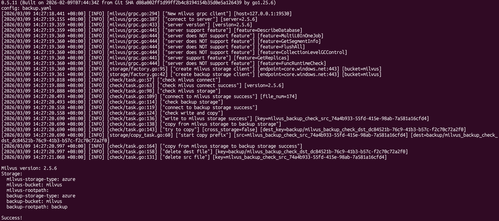
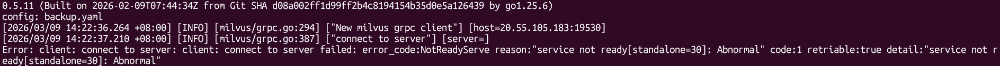
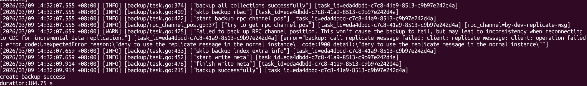

## 環境版本

- **Milvus**: `2.5.6`
- **milvus-backup**: `0.5.11`

## 概述

定期的備份資料是一件重要的事情，這裡的 Milvus 部署於 AKS 上，且底層儲存掛載在 Azure Blob Storage，接下來會介紹如何使用官方提供的備份工具進行備份

## 環境與儲存架構

資料持久化存放在 Azure Storage Account 內的 `milvus` Container 中，目錄結構如下：

```text
Azure Storage Account
└── milvus (Container)
    ├── insert_log/    # 寫入日誌與資料段
    └── stats_log/     # 統計資訊
```

目標是將備份檔案直接輸出到同一個 Container 下的 `backup/` 目錄中，方便集中管理

## 安裝 milvus-backup

首先需要確認機器可以正常使用 `azure-cli` 與 `kubectl` 連線到目標 AKS 叢集，這裡使用 Homebrew 安裝官方的備份工具 [milvus-backup](https://github.com/zilliztech/milvus-backup)：

```bash
brew install zilliztech/tap/milvus-backup
```

安裝完成後，可以執行 `milvus-backup --version` 確認工具可正常運作

## 設定連線與儲存參數

`milvus-backup` 需要同時與 **Milvus 服務本身（gRPC 介面）** 以及 **底層物件儲存（Azure Blob Storage）** 溝通，所以這裡在本機建立一個設定檔 `backup_config.yaml`

```bash
touch backup_config.yaml
```

將以下設定填入檔案中，並根據實際環境替換 `<YOUR-...>` 佔位符

```yaml
# 1. 負責與 Milvus (AKS) 溝通的連線設定
milvus:
  address: "<YOUR-MILVUS-URI>"            # 例如: 20.xxx.xxx.xxx，若走 port-forward 則填 127.0.0.1
  port: 19530                             # Milvus 預設 gRPC port
  authorizationEnabled: false             # 若有啟用帳號密碼驗證，請改為 true
  user: "root"                            # Milvus 帳號
  password: "Milvus"                      # Milvus 密碼

# 2. 負責與底層儲存 (Azure Storage) 溝通的連線設定
minio:
  # --- 來源端：讀取原本 Milvus 存放資料的位置 ---
  storageType: "azure"                    # 務必填寫 azure（即使區塊名稱叫 minio）
  address: "core.windows.net"             # Azure Blob 預設 endpoint
  port: 443
  accessKeyID: "<YOUR-STORAGE-ACCOUNT>"   # Azure Storage Account 名稱
  secretAccessKey: "<YOUR-ACCESS-KEY>"    # Storage Account 的 Access Key
  useSSL: true                            # 建議開啟 SSL
  bucketName: "milvus"                    # 原本存放 insert_log, stats_log 的 Container 名稱
  rootPath: ""                            # Milvus 資料在 Container 內的根目錄路徑

  # --- 目的端：設定備份檔案要輸出的位置 ---
  backupStorageType: "azure"
  backupAddress: "core.windows.net"
  backupPort: 443
  backupAccessKeyID: "<YOUR-STORAGE-ACCOUNT>"
  backupSecretAccessKey: "<YOUR-ACCESS-KEY>"
  backupBucketName: "milvus"              # 輸出在同一個 Container 即可
  backupRootPath: "backup"                # 備份檔會統一存放在 backup/ 路徑下
```

> 雖然 YAML 區塊的鍵名為 `minio`，但 `milvus-backup` 透過 `storageType: "azure"` 原生支援 Azure Blob Storage，無需額外架設 MinIO Gateway

## 驗證連線狀態

在正式執行備份前，先使用 `check` 指令測試 `milvus-backup` 是否能同時連通 Milvus 服務與 Azure Blob Storage

```bash
milvus-backup check --config backup_config.yaml
```

成功畫面應該會呈現下面這樣



### 常見連線問題排解



若 `check` 出現連線逾時或無法連線，多半是 Milvus 在叢集內設定 `ClusterIP`，未對外提供 Public IP。

可另開終端機，透過 `kubectl port-forward` 轉發 Milvus Proxy Pod（或對應 Service）到本地

```Bash
kubectl port-forward -n <NAMESPACE> <MILVUS-PROXY-POD-NAME> 19530:19530
```

通道建立後，將 `backup_config.yaml` 的 `milvus.address` 改為 `127.0.0.1`，重新執行 `milvus-backup check` 即可驗證連線

## 執行備份

確認連線無誤後，執行 `create` 指令建立備份。建議在備份名稱中加上日期（例如 `backup_2026_03_10`），方便日後識別與版本管理

```bash
milvus-backup create -n backup_2026_03_10 --config backup_config.yaml
```



當終端機輸出 `success` 字樣，即代表備份完成。此時回到 Azure Portal 查看 `milvus` Container，會發現系統已經自動建立好對應的備份資料夾與快照檔案

```text
Azure Storage Account
└── milvus (Container)
    ├── backup/
    │   └── backup_2026_03_10/   # 新增的完整備份目錄
    ├── insert_log/
    └── stats_log/
```

## Reference

- [Milvus Backup](https://milvus.io/docs/milvus_backup_overview.md)
- [zilliztech/milvus-backup](https://github.com/zilliztech/milvus-backup)